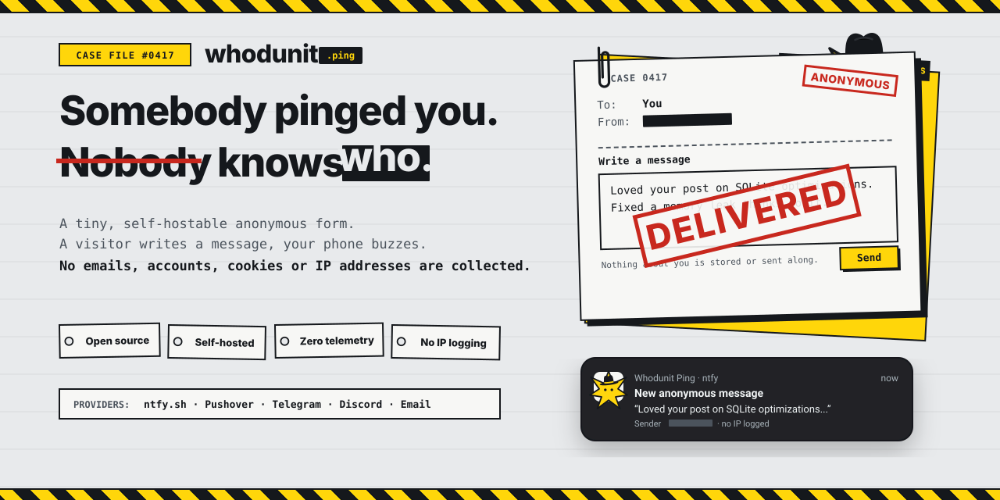

<p align="center">
  
</p>

# 🕵️‍♂️ Whodunit

> *"Somebody pinged you. Nobody knows who."*

A tiny, self-hostable, privacy-first anonymous "ping me" form and push notification engine.

A visitor types a message into a form on your site, and it arrives instantly as a push notification on your phone — with **zero identity attached to the sender**, zero persistent tracking, and zero telemetry.

Inspired by [samwho.dev/ping](https://samwho.dev/ping).

---

## ⚡ Highlights

- ⏱ **10-minute setup**: Deploy to Cloudflare Workers or Docker with one command.
- 📱 **Provider-agnostic**: Built-in support for **ntfy**, **Pushover**, **Telegram**, **Discord**, and **Email**.
- 🔒 **Private by default**: No sender IP addresses logged or stored; ephemeral rate limit keys rotate daily using one-way cryptographic salted hashing; zero third-party telemetry.
- 🧩 **Zero-dependency Web Component**: Embed `<whodunit-form>` into any site, Hugo, Astro, Next.js, or WordPress.
- 🌐 **Portable core**: Built entirely on standard Web APIs (`Request`, `Response`, `fetch`, Web Crypto). Runs natively on Cloudflare Workers, Node.js, Vercel Edge, Deno, and Bun.

---

## 📐 Architecture

```
 Any website
 ┌─────────────────────────────────────────┐
 │ <whodunit-form endpoint="/ping">        │  Web component (custom element)
 └────────────────────┬────────────────────┘
                      │ POST /ping { message, token?, hp }
                      ▼
 ┌────────────────────────────────────────────────────────┐
 │ @whodunit/core (Web-standard Request → Response)       │
 │  1. CORS & allowed origins check                       │
 │  2. Parse & length/type validation                     │
 │  3. Honeypot check (silent discard on bots)            │
 │  4. Bot check verifier (Turnstile / hCaptcha / none)   │
 │  5. Ephemeral salted rate limiting (daily rotating)    │
 │  6. Content sanitization (control characters stripped) │
 │  7. Multi-provider dispatch                            │
 └─────────────┬────────────────────────────┬─────────────┘
               │ RateLimitStore             │ Provider adapters
               ▼                            ▼
        Memory / KV / Redis       ntfy · Pushover · Telegram · Discord · Email
```

---

## 🚀 Quickstart

### Option A: Cloudflare Workers (Recommended, 100% Free)

1. Clone and navigate to the project:
   ```bash
   git clone https://github.com/your-username/whodunit.git
   cd whodunit
   pnpm install
   ```

2. Copy `.env.example` and set your ntfy topic:
   ```bash
   cp .env.example .env
   # Edit NTFY_TOPIC=my-secret-topic
   ```

3. Deploy using Wrangler:
   ```bash
   cd examples/cloudflare-worker
   npx wrangler deploy
   ```

### Option B: Docker / Self-Hosted Server

```bash
docker compose -f examples/docker-compose/docker-compose.yml up -d
```

### Option C: Standalone Node.js

```bash
pnpm install
pnpm build
pnpm run dev:node
```

The server will boot on `http://localhost:3000`.

---

## 📦 Packages in Monorepo

| Package | Description |
|---|---|
| [`@whodunit/core`](file:///Users/bhavya/dev/showcase/whodunit/packages/core) | Web-standard Request/Response handler, validation, rate limiting, and hashing |
| [`@whodunit/providers`](file:///Users/bhavya/dev/showcase/whodunit/packages/providers) | Push providers: ntfy, Pushover, Telegram, Discord, and Email |
| [`@whodunit/widget`](file:///Users/bhavya/dev/showcase/whodunit/packages/widget) | `<whodunit-form>` custom element with theming, honeypot, and accessible states |
| [`@whodunit/adapter-node`](file:///Users/bhavya/dev/showcase/whodunit/packages/adapters/node) | Standalone Node.js and Docker HTTP server adapter |
| [`@whodunit/adapter-cloudflare`](file:///Users/bhavya/dev/showcase/whodunit/packages/adapters/cloudflare) | Cloudflare Workers fetch handler and KV rate limit store |
| [`@whodunit/adapter-vercel`](file:///Users/bhavya/dev/showcase/whodunit/packages/adapters/vercel) | Vercel Edge and Serverless functions handler |
| [`@whodunit/adapter-deno`](file:///Users/bhavya/dev/showcase/whodunit/packages/adapters/deno) | Deno and Bun native runtime adapter |

---

## 🎨 Embedding the Form

Drop `<whodunit-form>` into your webpage:

```html
<script type="module" src="https://unpkg.com/@whodunit/widget/dist/index.js"></script>

<whodunit-form
  endpoint="https://your-api.domain.com/ping"
  placeholder="Say something anonymous..."
  button-text="Send Ping"
  max-length="500"
></whodunit-form>
```

Style it with CSS custom properties:

```css
whodunit-form {
  --whodunit-bg: #18181b;
  --whodunit-text: #fafafa;
  --whodunit-border: #27272a;
  --whodunit-btn-bg: #6366f1;
  --whodunit-btn-hover: #4f46e5;
  --whodunit-radius: 12px;
}
```

---

## 🛡️ Privacy & Security Manifesto

- **Zero Sender Logs**: We never forward or log sender IP addresses, user agents, or request headers.
- **Rotating Salted Hashes**: Ephemeral rate-limit keys are computed as `SHA-256(YYYY-MM-DD + salt + IP)`. When the day ends in UTC, the old hashes expire and become mathematically irrecoverable.
- **No Telemetry**: Zero analytics, zero phone-homes, zero third-party scripts.
- **Abuse Prevention**: Built-in honeypot traps, sliding-window rate limiters, global daily caps, and optional Cloudflare Turnstile bot checks.

See [SECURITY.md](file:///Users/bhavya/dev/showcase/whodunit/SECURITY.md) for vulnerability reporting and guidelines.

---

## 🧪 Testing

```bash
# Run all unit tests across all packages
pnpm test

# Typecheck TypeScript codebase
pnpm typecheck
```

---

## 🤝 Contributing & Architecture Decisions

- Read [DECISIONS.md](file:///Users/bhavya/dev/showcase/whodunit/DECISIONS.md) to explore the full Architecture Decision Records (ADRs).
- Read our [CONTRIBUTING.md](file:///Users/bhavya/dev/showcase/whodunit/CONTRIBUTING.md) guide to add new notification providers or adapters.

## 📄 License

MIT © [Whodunit Contributors](file:///Users/bhavya/dev/showcase/whodunit/LICENSE).
