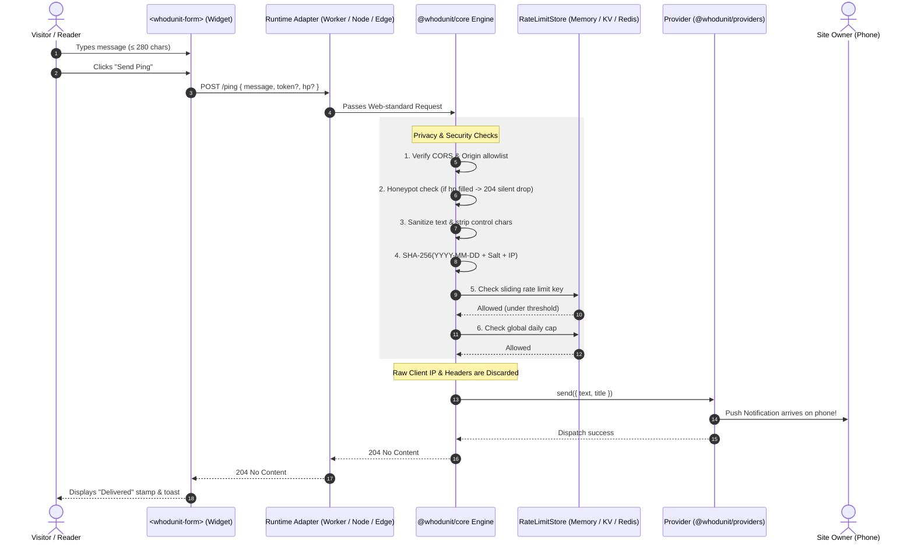

# Whodunit Architecture

> **"Somebody pinged you. Nobody knows who."**

This document details the end-to-end technical architecture of **Whodunit**, its privacy guarantees, and answers the fundamental question: **"Why not just trigger a Discord webhook directly from the browser?"**

---

## 1. Why Not Just Trigger a Discord Webhook?

When building an anonymous ping form, the most common question is: *“Why do I need a backend at all? Can’t I just `fetch()` a Discord or Slack webhook URL directly from clientside JavaScript?”*

Putting a direct webhook in your frontend has **five critical flaws**:

```
❌ NAIVE CLIENT-SIDE WEBHOOK:
Visitor Browser ─── [Exposes Secret Webhook URL in JS] ───▶ Discord Server ───▶ Your Phone
                     • Anyone can steal your webhook URL
                     • Discord logs the visitor's real IP & user-agent
                     • Zero spam protection / infinite notification floods
                     • No honeypots or character sanitization

✅ WHODUNIT BUFFERED ARCHITECTURE:
Visitor Browser ─── [Zero Secrets in DOM] ───▶ Whodunit Core ───▶ Provider (ntfy/Discord) ───▶ Your Phone
                                               • Origin & CORS verification
                                               • Silent honeypot trap
                                               • Daily-salted ephemeral IP hashing
                                               • Raw IP & client headers dropped
                                               • Max 280-char sanitized text only
```

### The 5 Fatal Problems with Direct Webhooks

| Problem | Direct Webhook (`fetch(discordWebhook)`) | Whodunit (`<whodunit-form>` + Core) |
|---|---|---|
| **1. Secret Token Leaks** | **Fatal.** The webhook URL containing your private token is visible to anyone inspecting DOM/Network tab. Anyone can hijack or delete it. | **Protected.** The webhook secret lives only in your server environment (`.env`). The client only knows `/ping`. |
| **2. Sender Privacy & Anonymity** | **None.** Discord and Slack log the visitor's real IP address, TLS fingerprint, User-Agent, and geolocation metadata on every POST. | **Mathematically Private.** Raw IP addresses and request headers are immediately dropped. Ephemeral rate limiting uses daily-salted hashes. |
| **3. Notification Floods & Abuse** | **No protection.** Anyone with `curl` can loop 10,000 POST requests in 30 seconds and blow up your phone or crash Discord. | **Multi-layered defense.** Ephemeral sliding-window limits, global daily caps (e.g. max 50 pings/day), and optional Turnstile challenges. |
| **4. Bot Scraping & Honeypots** | **None.** Automated form-fill bots crawl the web and trigger notifications on every hit. | **Silent honeypot.** Bots that fill hidden inputs receive a fake `204 OK` and their messages are silently discarded. |
| **5. Mobile Push Experience** | **Poor.** Discord is a team chat app requiring active servers, notification roles, and app permissions. | **True Push.** Routes directly to **ntfy.sh**, Pushover, Telegram, Discord, or Email as native phone push notifications. |

---

## 2. End-to-End System Pipeline



---

## 3. Core Engine Pipeline (`@whodunit/core`)

Every request passing through `createHandler()` undergoes an ordered series of validation gates:

```
                  POST /ping
                      │
                      ▼
         [ 1. Emergency Kill-Switch ] ──▶ (Disabled? Return 503)
                      │
                      ▼
         [ 2. CORS Preflight & Origin ] ──▶ (Disallowed? Return 403)
                      │
                      ▼
         [ 3. Honeypot Detection ] ─────▶ (Bot filled 'hp'? Return silent 204)
                      │
                      ▼
         [ 4. Input Sanitization ] ─────▶ (Strip control chars, enforce max 280)
                      │
                      ▼
         [ 5. Bot Verification ] ───────▶ (Turnstile / hCaptcha token check)
                      │
                      ▼
         [ 6. Daily-Salted IP Hash ] ───▶ (Exceeded sliding window? Return 429)
                      │
                      ▼
         [ 7. Global Daily Cap ] ───────▶ (Exceeded max pings/day? Return 429)
                      │
                      ▼
         [ 8. Demo Bypass Check ] ──────▶ (If demo=true -> Return 204, skip providers)
                      │
                      ▼
         [ 9. Multi-Provider Dispatch ] ─▶ Promise.all(providers.map(p => p.send()))
                      │
                      ▼
             HTTP 204 No Content
```

### Key Security & Privacy Mechanics

1. **Daily-Salted Ephemeral Hash**:
   To prevent tracking visitors across days while still preventing short-term spam, the rate limiter computes:
   $$\text{Key} = \text{SHA-256}(\text{YYYY-MM-DD} \parallel \text{salt} \parallel \text{client\_ip})$$
   - When the UTC date rolls over, the previous day's hashes are mathematically dissociated from future requests.
   - The raw IP address is **never logged, stored, or passed to notification providers**.

2. **Silent Honeypot Trap**:
   - The form includes a hidden input `<input name="hp" tabindex="-1">` styled offscreen.
   - Real users never see or fill this field. Automated scrapers fill every input.
   - If `hp` has any value, the server returns `HTTP 204` without sending a push notification. The bot thinks it succeeded and does not retry.

3. **Global Daily Safety Cap**:
   - Protects against distributed botnets where thousands of unique IPs each send 1 message.
   - If `DAILY_CAP=50` is configured, your phone will never receive more than 50 pings in a 24-hour window, preventing denial-of-sleep attacks.

4. **Demo Mode Isolation**:
   - The demo form on the landing page attaches `demo: true` and `?demo=1`.
   - The engine validates format and rate-limits demo users, but skips dispatching to your notification services, ensuring public visitors trying the landing page never trigger random pings on your device.

---

## 4. Monorepo Architecture

Whodunit is organized as a lightweight pnpm workspace:

```
whodunit/
├── packages/
│   ├── core/               # Zero-dependency Web-standard Request/Response handler
│   │   ├── src/
│   │   │   ├── handler.ts      # createHandler() pipeline
│   │   │   ├── crypto.ts       # Web Crypto daily hashing
│   │   │   ├── clean.ts        # Message sanitization
│   │   │   ├── cors.ts         # CORS & origin allowlisting
│   │   │   └── client-ip.ts    # CF-Connecting-IP / X-Forwarded-For parser
│   │   └── tests/
│   │
│   ├── providers/          # Notification dispatch adapters
│   │   ├── src/
│   │   │   ├── ntfy.ts         # ntfy.sh push provider (primary)
│   │   │   ├── pushover.ts     # Pushover push API
│   │   │   ├── telegram.ts     # Telegram Bot API
│   │   │   ├── discord.ts      # Discord webhook adapter
│   │   │   └── email.ts        # Resend / SMTP email
│   │   └── tests/
│   │
│   ├── widget/             # Vanilla Web Component (<whodunit-form>)
│   │   └── src/
│   │       └── whodunit-form.ts # Shadow DOM custom element (< 3KB)
│   │
│   └── adapters/           # Thin runtime wrappers (< 60 lines each)
│       ├── cloudflare/     # Cloudflare Workers (export default { fetch })
│       ├── node/           # Node.js http.IncomingMessage -> Web Request
│       ├── vercel/         # Vercel Edge Runtime handler
│       └── deno/           # Deno.serve() adapter
│
├── examples/               # Production deployment blueprints
│   ├── cloudflare-worker/  # Serverless deployment
│   └── docker-compose/     # Self-hosted Docker container
│
└── public/                 # Landing page & brand assets
    ├── index.html          # Case-file detective themed landing page
    ├── mascot.svg          # Starburst detective mascot
    ├── banner.png          # High-res README banner
    └── favicon.svg         # Tab favicon
```

---

## 5. Architectural Contracts

### The `Provider` Interface

All notification services implement a simple, decoupled contract:

```typescript
export interface Provider {
  readonly name: string;
  send(msg: { text: string; title?: string }): Promise<void>;
}
```

Adding a new notification destination (e.g., Matrix, Gotify, Signal) requires only implementing this interface and registering it in `packages/providers/src/resolver.ts`.

### The `RateLimitStore` Interface

```typescript
export interface RateLimitStore {
  hit(key: string, limit: number, windowSec: number): Promise<boolean>;
}
```

- **Memory**: Default for Node and persistent servers (`MemoryRateLimitStore`).
- **Cloudflare KV**: For serverless edge deployments (`KvRateLimitStore`).
- **Redis / Upstash**: For distributed multi-region deployments.

---

## 6. Summary Comparison

| Dimension | Direct Discord Webhook | Generic SaaS Form | Whodunit |
|---|---|---|---|
| **Server Cost** | Free | $10–$25/mo | 100% Free (Cloudflare Workers / Docker) |
| **Sender Privacy** | Discord logs visitor IP | SaaS logs visitor IP & cookies | Raw IP never stored or logged |
| **Secret Security** | Webhook URL exposed in HTML | Form ID public | Webhook token secure on server |
| **Spam Protection** | None | Captcha wall (poor UX) | Silent Honeypot + Ephemeral Salted Hash |
| **Destination** | Discord only | Email inbox (slow) | ntfy push to phone in < 500ms |
| **Lock-in** | Discord proprietary | Proprietary SaaS | Open Source & Self-Hostable |
